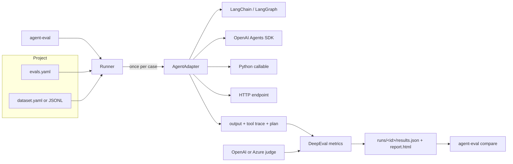
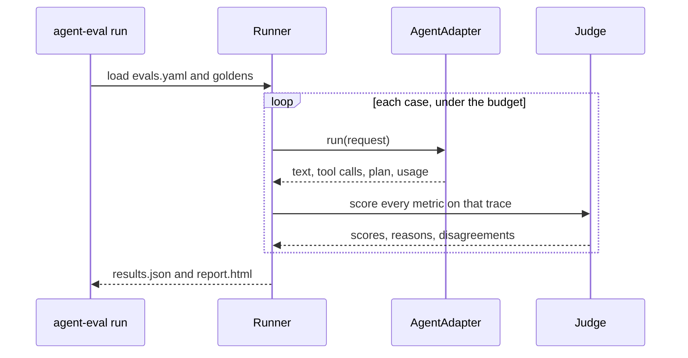

# agent-eval-harness

Project-agnostic evaluation harness for AI agents. Each test case runs **once**. The adapter captures the answer and the tool-call trace, and every metric scores that same capture. Built on [DeepEval](https://github.com/confident-ai/deepeval).

The usual tutorial pattern calls the agent again for every metric, hard-codes paths, and throws the scores away. This harness keeps one config per project, writes a versioned run, and diffs the next run against it.

## Architecture





A case that errors in the adapter is stored as an error and is not sent to the judge. Deterministic metrics (`tool_correctness`, and custom metrics unless `judged: true`) sample once. Judged metrics use `judge.samples`.

## Install

Python 3.11+. [uv](https://docs.astral.sh/uv/) manages the project.

```bash
uv sync --all-extras
```

`langchain` and `openai-agents` are optional extras. The core install is enough for the Python and HTTP adapters.

## Quickstart

Inside this repo:

```bash
uv run agent-eval init --dir evals
```

`init` writes `evals.yaml` and `dataset.yaml` and will not overwrite either file. Point `adapter.target` at `package.module:attribute`, fill in the dataset, and export `OPENAI_API_KEY`. The judge refuses to run without a key. It does not invent scores.

```bash
export OPENAI_API_KEY=sk-...
uv run agent-eval run --config evals/evals.yaml
uv run agent-eval report --latest --config evals/evals.yaml
```

To evaluate a different repository, install this package there (`uv add --editable` against a checkout, or a git dependency) and run the same `agent-eval` commands from that project.

`run` exits **0** when every scored case passes, **1** when a threshold fails or the agent errors, and **2** when the budget stops the run before any threshold failure. Config errors also exit 1. That is the CI signal.

Paths in `evals.yaml` are relative to the config file. The project root (the directory that contains `pyproject.toml`, walking up from the config) is put on `sys.path` so `target` can import the agent.

## Plug in an agent

`AgentAdapter.run(request) -> AgentResult`. `request` carries `case_id`, `input`, prior `turns`, `session_id`, and `metadata`. The result carries `output`, `tool_calls` (`name`, `arguments`, `output`), `plan`, `usage`, and `error`.

| `adapter.type` | What `target` is | Notes |
| --- | --- | --- |
| `python` | function | A single `str` parameter receives the user text. Any other signature receives `AgentRequest`. Return `str`, `dict`, or `AgentResult`. `factory: true` calls `target(**kwargs)` first. |
| `langchain` or `langgraph` | factory returning a runnable | Invoked with `{messages: [...]}`. A `TypeError` falls back to `{input: ...}`. Reads `AIMessage.tool_calls`, `ToolMessage` outputs, `Plan:` lines, and a structured `{answer, conversation}` payload. |
| `openai_agents` | factory returning an Agent | Uses `Runner.run_sync`. Reads tool call items, tool outputs, and the final message. |
| `http` | `url` instead of `target` | `POST` JSON `{input, turns, session_id, metadata, case_id}`. Response JSON matches `AgentResult`. Header values may use `${ENV_VAR}`. |

```yaml
adapter:
  type: python
  target: my_agent.agent:run
```

```python
def run(user_text: str) -> str:
    return "Order 17 was delivered."
```

LangGraph and the OpenAI Agents SDK use the same shape, with `target: my_agent.agent:build_agent` and optional `kwargs`.

## Dataset

YAML (`cases:` list, or a bare list) or JSONL. One object per line in JSONL.

```yaml
cases:
  - id: order-17
    input: What is the status of order 17?
    expected_output: Order 17 was delivered.
    tags: [smoke]
    expected_tools:
      - name: lookup_order
        arguments: {order_id: "17"}
    turns:                      # prior context; the current ask is `input`
      - role: user
        content: I need help with an order.
      - role: assistant
        content: What is the order id?
```

- `expected_tools` omitted: `tool_correctness` is skipped for that case.
- `expected_tools: []`: the agent must call nothing.
- `arguments` omitted on a tool: the name is checked and the arguments are not.
- `task` on a case overrides the metric-level task description for `task_completion`.

## Metrics

| Name | Kind | What it scores |
| --- | --- | --- |
| `task_completion` | judged, trace | Did the trajectory finish the `task` description? |
| `step_efficiency` | judged, trace | Were the steps necessary? |
| `plan_quality` | judged, trace | Quality of the captured plan. |
| `plan_adherence` | judged, trace | Did the trajectory follow that plan? |
| `tool_correctness` | deterministic | Called tools against `expected_tools`. `exact_match`, `consider_ordering`, and `input_parameters` match the DeepEval flags. |
| `argument_correctness` | judged | Are the arguments the model passed reasonable? |
| `answer_correctness` | GEval | Same logical conclusion as `expected_output`. Set `criteria` or `evaluation_steps`. |
| `custom` | your code | `target: package.module:build` |

Plan metrics read a nested trace. The LangChain and OpenAI adapters treat lines that start with `Plan:` as the plan. If no plan was captured, the HTML report says so. An empty plan is a weak signal for those two metrics; fix the agent prompt rather than the score.

Judge samples (1–10) are aggregated by median. A metric **disagrees** when `max - min` exceeds `disagreement_spread` or the samples split on pass/fail. Disagreements are listed in the text summary and the HTML report. `fail_on_disagreement: true` turns a disagreement into a failed case. `tool_correctness` is sampled once unless `available_tools` is set (that path asks the judge). A custom metric is sampled once unless `judged: true`.

### Custom metric

`target` is a callable. It receives `threshold`, `model`, and the `params` mapping, and returns an object with `measure(test_case)`, `score`, `reason`, and `success`.

```python
class TicketGateMetric:
    def __init__(self, threshold: float = 1.0, model=None, **params):
        self.threshold = threshold
        self.score = 0.0
        self.reason = ""
        self.success = False

    def measure(self, test_case, **kwargs) -> float:
        self.score = 1.0
        self.success = self.score >= self.threshold
        self.reason = "ok"
        return self.score


def build(**kwargs):
    return TicketGateMetric(**kwargs)
```

```yaml
- name: ticket_gate
  type: custom
  target: my_agent.metrics:build
  threshold: 1.0
```

## Judge

```yaml
judge:
  provider: openai          # openai | azure
  model: gpt-4.1-mini       # default
  samples: 3
  disagreement_spread: 0.25
```

OpenAI reads `OPENAI_API_KEY`, or the variable named by `api_key_env`. Azure reads `AZURE_OPENAI_API_KEY` and `AZURE_OPENAI_ENDPOINT` (override with `api_key_env` and `endpoint_env`) plus `deployment` and `api_version`. Missing credentials raise `ConfigError` and the run stops. The harness does not substitute a fake judge.

Cost uses the provider's reported evaluation cost when DeepEval sets one, otherwise token counts against a small price table, otherwise `budget.assume_judge_call_usd` (default `$0.002`) times the number of judge calls. `judge.samples: 3` multiplies judged-metric calls by three. Deterministic metrics stay at one sample.

## Run, cache, budget

```bash
uv run agent-eval run --config evals.yaml
uv run agent-eval run --config evals.yaml --case full_refund --tag refund
uv run agent-eval run --config evals.yaml --concurrency 8 --budget 1.50 --max-cases 20
uv run agent-eval run --config evals.yaml --no-cache
```

The cache is a directory of JSON files (`run.cache_dir`). The agent key covers the adapter config, the request, and a digest of the Python package next to `target`. The metric key covers the judge, the metric config, the golden, the agent result, and the sample index. Errors are not cached.

The budget is a soft cap: `max_usd`, `max_cases`, `max_judge_calls`. A case is reserved before it starts. A case already in flight is allowed to finish. When the cap stops the run and nothing else failed, the process exits 2.

Each run is a directory named `{UTC timestamp}-{6 hex}` under `run.runs_dir`:

```
runs/20261021T140000Z-a1b2c3/
  results.json    # schema_version 1
  report.html     # self-contained
  evals.yaml      # snapshot of the config
```

The HTML report has per-metric averages and pass rates, a disagreement section, a plan-capture warning, and a per-case drilldown (judge reasons, tool trace, tokens, cost).

## Compare

```bash
uv run agent-eval compare runs/<baseline> runs/<candidate>
uv run agent-eval compare runs/<baseline> runs/<candidate> --delta 0.05
uv run agent-eval compare runs/<baseline> runs/<candidate> --allow-regression
```

A regression is a pass that became a fail, or a score drop of at least `run.regression_delta` (default 0.05). A case present only in the baseline counts as a regression. The command writes `compare-<baseline_run_id>.json` and `.html` next to the candidate run and exits 1 when any regression is present.

## Example: refund agent

`examples/refund_agent/` is the tutorial refund agent, split into a policy, tools, and two prompts that share one dataset.

Policy clock is fixed at **2026-10-21**, window **30 days**, so the goldens do not rot. History rows already include `within_window`, which is why the improved agent must not call `get_today_date`.

| User | Purchases on the clock |
| --- | --- |
| `u_alice` | headphones $80 (in window), keyboard $120 (out). No tablet. |
| `u_bob` | laptop sleeve $30, mouse $25 (both in window). |
| `u_cara` | monitor $300 (out of window). |
| `u_dana` | unknown user. |

Cases: `full_refund`, `partial_refund`, `policy_question` (no tools), `unknown_user`, `out_of_window`, `mixed_eligibility`, `never_purchased`, `followup_refund` (multi-turn). `expected_tools` is the improved sequence, with exact arguments and order.

The **improved** prompt looks up history, quotes only requested items that are `within_window`, and opens one human-approval ticket for the exact eligible total. The **baseline** prompt always calls `get_today_date`, quotes every mentioned item, passes whatever identifier is handy, and tickets every mentioned item if any quote looks eligible. `ticket_gate` is a deterministic custom metric: every `issue_refund_ticket` call must be one the policy function would accept.

Live scores need `OPENAI_API_KEY` and are not checked in. Run them locally:

```bash
export OPENAI_API_KEY=sk-...
uv run agent-eval run --config examples/refund_agent/evals.baseline.yaml
uv run agent-eval run --config examples/refund_agent/evals.yaml
uv run agent-eval compare examples/refund_agent/runs/<baseline-id> examples/refund_agent/runs/<improved-id>
```

| Metric | Baseline | Improved |
| --- | --- | --- |
| task_completion | run locally | run locally |
| step_efficiency | run locally | run locally |
| plan_quality | run locally | run locally |
| plan_adherence | run locally | run locally |
| tool_correctness | run locally | run locally |
| argument_correctness | run locally | run locally |
| answer_correctness | run locally | run locally |
| ticket_gate | run locally | run locally |

What should move, before you read the numbers: `tool_correctness` is exact-match and order-sensitive, and the goldens do not include `get_today_date` or quotes for ineligible items, so the baseline's extra calls miss that metric. `step_efficiency` should move for the same reason (a date lookup the history already answered, plus quotes the policy will reject). `ticket_gate` fails closed when a ticket lists an ineligible item or the wrong total. `answer_correctness` is a judge call on the logical conclusion (eligibility, items, amount, human approval), so treat a single run as a sample and read the disagreement column when `samples` is greater than 1.

`REFUND_AGENT_MODEL` selects the chat model (default `gpt-4.1-mini`). The judge model is `judge.model` in the yaml.

## Development

```bash
uv sync --all-extras
uv run ruff check .
uv run ruff format --check .
uv run pytest
```

Tests stub the judge and the agent. They do not call OpenAI. CI runs ruff and pytest on Python 3.11 and 3.12.

## License

MIT. Copyright (c) 2026 Monish Gosar.
